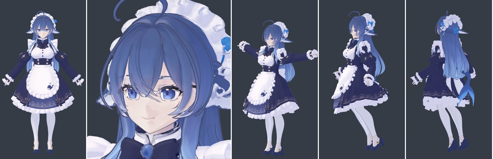

# DeepSeek Whale Girl 3D · 大肥鱼第二版

从角色立绘、多视图参考和 Tripo 生成部件，到 Blender 装配、绑定、物理与卡通渲染的项目归档，附配套 **建模 SKILLS、脚本与验收记录**。

> A working-file archive of Whale Girl v2, with reference art, generated model parts, Blender checkpoints, and an anime-character production skill pack. This is not a one-click reconstruction pipeline. Code/scripts use MIT; project assets and documentation use CC BY-NC-SA 4.0 only where the maintainer has the right to grant that license. See [许可与来源](docs/LICENSING.md).



*上图为保留的 t001 阶段验收图，不代表 t002 的重新渲染。优先查看的工程是 `FISH2_toon_t002.blend`。*

## 这里有什么？

- **角色工程**：原图、拆件提示词、多视图参考、Tripo FBX/贴图与下载压缩包。
- **Blender 工作阶段**：素体修复 → 服装和配件装配 → 骨骼绑定 → 动态烘焙 → 卡通材质与描边。
- **OC5 参考工程**：`外部参考/OC第五版/OC5_anime_toon_v018.blend`，用于卡通材质与渲染参考。
- **过程证据**：不同阶段的对比图、验收图、修复和动态验证 JSON。
- **建模 SKILLS**：面向人的经验手册，以及面向 AI Agent 的技能入口、10 篇阶段参考、4 个脚本与 3 个模板。

本项目包含 AI 辅助制作与人工/脚本修正流程；Tripo 输出并不等于最终绑定、物理和卡通成品。项目名不是 DeepSeek、Tripo 或 Blender 官方背书。

## 获取完整工程

本仓库对 `.blend`、`.fbx`、`.zip` 和装配阶段的大尺寸 PNG 贴图使用 **Git LFS**。普通预览图保留在 Git 中，方便在线浏览。

```bash
git lfs install
git clone https://github.com/azwosile/DeepSeek-whale-girl-3D.git
cd DeepSeek-whale-girl-3D
git lfs pull
```

若下载到的工程文件只有几行、开头是 `version https://git-lfs.github.com/spec/v1`，那是 LFS 指针，不是模型本体。请完成 LFS 下载。网页 Download ZIP 是否包含大文件取决于仓库设置，优先使用上述方式。

## 从哪里开始？

| 目的 | 入口 |
|---|---|
| 查看较新的卡通完成版 | [FISH2_toon_t002.blend](大肥鱼第二版/装配/FISH2_toon_t002.blend) |
| 查看绑定 | [FISH2_rig_r002.blend](大肥鱼第二版/装配/FISH2_rig_r002.blend) |
| 查看动态烘焙 | [FISH2_phys_p002.blend](大肥鱼第二版/装配/FISH2_phys_p002.blend) |
| 查看装配修复 | [FISH2_assembly_f004.blend](大肥鱼第二版/装配/FISH2_assembly_f004.blend) |
| 阅读流程经验 / 使用技能 | [建模SKILLS/README.md](建模SKILLS/README.md) |
| 了解复现限制 | [已知限制](docs/KNOWN_LIMITATIONS.md) |
| 维护者首次上传 | [上传指南](docs/UPLOAD.md) |

源技能文档记录的制作环境为 **Blender 5.2.2 LTS**；这是历史记录，并非此次重新验证的版本兼容性结论。本次仓库整理没有运行 Blender、重烘焙物理或重渲染工程。

在本地副本中打开工程；若贴图缺失，可尝试 Blender 的 **File → External Data → Find Missing Files**，选择 `大肥鱼第二版/`。这只是修复路径的操作建议，不能替代干净环境下的实际验收。不要直接运行历史修复脚本覆盖交付工程。

## 目录

```text
DeepSeek-whale-girl-3D/
├─ 大肥鱼第二版/
│  ├─ 原图/             立绘、设定图、拆图提示词
│  ├─ 生成参考图/       素体与女仆装多视图
│  ├─ 生成模型/         FBX、配套 .fbm 贴图、原始 ZIP、评估图
│  └─ 装配/             各阶段 .blend、脚本、报告、验收图、tex/
├─ 外部参考/OC第五版/    OC5 卡通渲染参考工程
├─ 建模SKILLS/
│  ├─ README.md
│  ├─ 二次元角色建模全流程经验.md
│  ├─ 参考文档/
│  └─ anime-character-pipeline/
│     ├─ SKILL.md
│     ├─ references/
│     ├─ scripts/
│     └─ templates/
├─ docs/                发布、限制与来源说明
├─ manifests/           文件校验清单与整理检查报告
├─ .gitattributes       Git LFS 与文本规则
└─ .gitignore           备份、缓存、凭据排除规则
```

共复制原始项目与技能文件 **99 个**，另加入 `外部参考/OC第五版/OC5_anime_toon_v018.blend`；排除 **8 个 `.blend1` 自动备份**，其余阶段工程、原始 ZIP 与贴图均保留。源目录未修改。逐文件大小和 SHA-256 见 [来源清单](manifests/source-files.json)。

## SKILLS 的使用

先阅读 [技能说明](建模SKILLS/README.md)，再让支持技能的 Agent 读取 [SKILL.md](建模SKILLS/anime-character-pipeline/SKILL.md) 及相关参考文档。技能不是 Blender 插件，也不意味着本仓库包含 DSH 运行环境。安装方式取决于所用 Agent；不要直接照搬文档里的历史本机路径。

`建模SKILLS/anime-character-pipeline/scripts/` 的四个工具分别用于结构审计、版本对比、多视图渲染与运动指标；具体参数以脚本为准。源资料里的实测结果是原作者的历史记录，本次整理没有重跑这些实验。

## 制作链路

```text
立绘 / 部件设定 → 多视图 → Tripo 部件生成
    → Blender 修复与装配 → 绑定与姿势检查
    → 动态/物理处理 → 卡通材质、描边与验收
```

本仓库保留制作检查点，**不保证从原图一键重建最终工程**。部分早期脚本缺少仓库外依赖；详见 [已知限制](docs/KNOWN_LIMITATIONS.md)。

## 许可与来源

代码与脚本采用 [MIT](LICENSE-MIT)；角色图像、模型、贴图、Blender 工程和项目文档在作者有权授权的范围内采用 [CC BY-NC-SA 4.0](LICENSE-CC-BY-NC-SA-4.0)。第三方内容不自动纳入许可。角色来源、OC5 工程与限制见 [许可与来源说明](docs/LICENSING.md)。

欢迎提交问题、文档勘误与可复现的修复建议；贡献前请先与维护者确认许可安排。提交改动时保留原检查点，不上传密钥、临时传输缓存或自动备份。动画案例中列入依赖清单的必要 PC2 缓存通过 Git LFS 发布。

## 动画案例：更衣室大战 r033

新增[双角色动画完整发布工程](动画案例/更衣室大战/README.md)，包括相对路径依赖、必要 PC2、有声与无声成片、验证报告，以及[缓存与交付经验](建模SKILLS/参考文档/更衣室大战_r033_缓存与成片交付.md)。

缓存和 MP4 使用 Git LFS；只下载最终 blend 不能完整播放本案例。该案例允许轻微穿模，不是零穿透物理认证。发布者已确认公开分发权限，具体声明见案例许可文件。此新增案例的验证不扩展为对仓库其他历史工程的重新验收。

## 链接与资料

- [本项目 GitHub 仓库](https://github.com/azwosile/DeepSeek-whale-girl-3D)
- [源技能资料与致谢](建模SKILLS/anime-character-pipeline/references/10-references.md)
- [GitHub：配置 Git LFS](https://docs.github.com/en/repositories/working-with-files/managing-large-files/configuring-git-large-file-storage)
- [GitHub：Git LFS 说明](https://docs.github.com/en/repositories/working-with-files/managing-large-files/about-git-large-file-storage)

仓库整理日期：2026-10-08。
